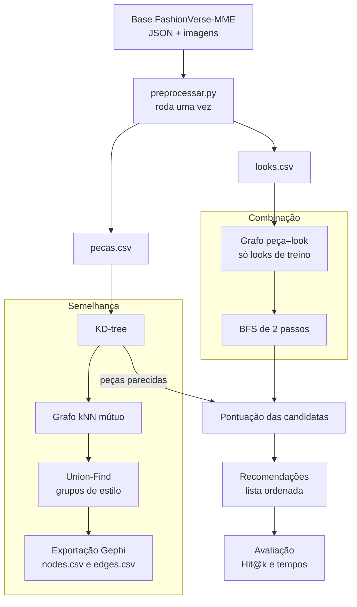

# Arquitetura do projeto

Este documento explica o projeto inteiro. Não é preciso conhecimento prévio de KD-tree ou de Union-Find.

## 1. O que o sistema faz

O sistema responde duas perguntas sobre peças de roupa.

1. **Quais peças são parecidas com esta?** Exemplo: outras camisas claras e lisas parecidas com uma camisa branca de linho.
2. **O que combina com este look?** Exemplo: um look tem camisa branca e calça jeans e falta o sapato. Qual sapato completa o look?

As duas perguntas são diferentes. Uma peça parecida com uma camisa é outra camisa. Uma peça que combina com uma camisa é uma calça, uma saia ou um sapato. Por isso o projeto usa estruturas diferentes.

| Pergunta | Estrutura | Informação usada |
| --- | --- | --- |
| Quais peças são parecidas? | KD-tree | atributos da peça (cor, variação de cor, formalidade) |
| O que combina com este look? | grafo peça–look + BFS | looks reais montados por pessoas |
| Quais grupos de estilo existem? | grafo de similaridade + Union-Find | peças parecidas ligadas entre si |

## 2. Pergunta de pesquisa

Usar a semelhança entre peças (KD-tree) junto com a informação dos looks (grafo) completa looks melhor do que usar só uma das duas? E como o tempo das estruturas cresce quando o número de peças aumenta?

A tabela de Hit@k responde à primeira parte. O gráfico de tempo responde à segunda.

## 3. Visão geral

O projeto tem duas partes. O Python prepara os dados uma única vez e grava CSVs. O C++ lê os CSVs e faz todo o trabalho das estruturas.

As duas partes só se comunicam por CSV. Motivo: a base original vem em JSON, e ler JSON em C++ exige biblioteca externa. Ler CSV exige só a biblioteca padrão.

Quem for rodar o projeto não precisa do Python. Motivo: o resultado do Python fica publicado no Zenodo.



## 4. Os dados

### Base principal: FashionVerse-MME

Está no Mendeley Data, com DOI 10.17632/6sx3pbsfvz.1 e licença CC BY 4.0. Foi criada a partir da base Polyvore, que tem licença Apache 2.0. O arquivo usado é o `Combined_Metadata.json`, com 126.928 registros em 20 categorias.

Para cada peça, a base traz:

- categoria
- imagem
- cor dominante e paleta de cores, calculadas com k-means
- descrições geradas por modelos (BLIP e LLaMA)
- os looks em que a peça aparece

Motivos da escolha:

- Está em um repositório aceito pelo professor.
- Tem looks reais. Sem eles não existe o grafo peça–look.
- Já tem as cores. Não é preciso rodar visão computacional nas imagens.
- É grande. Permite medir o tempo de 1 mil até 100 mil peças.

### O que a base tem de diferente do esperado

O JSON não tem um campo de look. O look sai do nome do arquivo: `200266907_1.jpg` é a peça 1 do look 200266907.

Esse nome é único, então cada registro aparece em um look só. Com isso, a BFS nunca sairia do próprio look. A solução foi juntar os registros com a mesma categoria, os mesmos três RGB e a mesma legenda do BLIP, porque a mesma imagem gera esses mesmos valores. O resultado são 102.370 peças, e cerca de 14% delas aparecem em mais de um look.

Consequência: em 1.600 dos 5.842 looks de teste (27%) a peça escondida existe no treino. Esse é o teto de acerto das versões B e C.

Outros ajustes: `outwear` vira `outerwear`, `watches` vira `watch`, e 277 registros cujo nome não segue o padrão são descartados. A descrição da base fala em 21.889 looks, mas os nomes dos arquivos dão 31.609. O projeto usa os nomes dos arquivos.

### Base opcional: roupas de segunda mão da Noruega

Está no Zenodo, com DOI 10.5281/zenodo.20440761 e licença CC BY-SA 4.0. Tem 16.464 peças, mas não tem looks. Só serviria para a parte de semelhança. Só entra se o professor exigir duas bases. Não existe código para ela neste repositório.

### Bases descartadas

| Base | Motivo |
| --- | --- |
| H&M (Kaggle) | não está no Zenodo nem no Mendeley e não pode ser republicada |
| CelebAMask-HQ | a parte de rosto saiu do escopo |
| MST-E | a parte de rosto saiu do escopo |

## 5. Pré-processamento e formato dos arquivos

Passos do `preprocessar.py`:

1. Ler o JSON da FashionVerse.
2. Descartar registros sem cor, sem categoria ou com nome fora do padrão e juntar as peças repetidas.
3. Converter a cor dominante e a paleta de RGB para Lab.
4. Calcular os atributos numéricos e normalizar todos para o intervalo de 0 a 1.
5. Multiplicar cada atributo por √w, em que w é o peso dele.
6. Dividir os looks em treino (80%) e teste (20%), com semente fixa 42.
7. Gravar `pecas.csv` e `looks.csv`.
8. Gerar subconjuntos com 1 mil, 10 mil e 100 mil peças.

A semente é fixa porque assim a divisão é a mesma para todo mundo que rodar o script.

```
pecas.csv   (uma linha por peça)
id,categoria,L,a,b,variacao_cor,formalidade
0,camisa,0.95,0.50,0.52,0.08,0.44

looks.csv   (uma linha por peça dentro de um look)
look_id,peca_id,conjunto
12,0,treino
12,1,treino
13,4,teste
```

## 6. Como uma peça vira um vetor

Regra: só vira número um atributo em que um valor intermediário faz sentido. Formalidade 0,5 faz sentido. "Categoria 2,5" não faz.

| Atributo | Papel | Como é calculado |
| --- | --- | --- |
| categoria | filtro, não entra no vetor | vem pronta da base |
| L, a, b | 3 números | cor dominante em Lab |
| variacao_cor | 1 número | média da distância entre as cores da paleta e a cor dominante. Peça lisa fica perto de 0. Peça estampada fica perto de 1 |
| formalidade | 1 número | contagem de palavras formais e casuais na descrição, com uma lista feita pela dupla |

O vetor final tem 5 números. Os pesos iniciais são 1 para L, a, b e variacao_cor, e 0,5 para formalidade. A formalidade pesa menos porque a regra dela é mais simples e menos confiável.

Fórmula da distância com pesos:

```
d(p, q) = √( w1(p1 − q1)² + w2(p2 − q2)² + ... + w5(p5 − q5)² )
```

Exemplo com 2 atributos e pesos 1 e 0,5. Sejam p = (0,9; 0,4) e q = (0,5; 0,2).

```
d² = 1 × (0,9 − 0,5)² + 0,5 × (0,4 − 0,2)²
d² = 0,16 + 0,02 = 0,18
d  = 0,42
```

Motivos das decisões:

- **Lab e não RGB.** No Lab, a distância entre cores acompanha o que o olho percebe. No RGB, não.
- **Categoria como filtro.** Se camisa = 1, calça = 2 e sapato = 3, o sistema acharia que camisa está mais perto de calça do que de sapato. Isso não tem significado.
- **Poucos números.** A KD-tree perde eficiência com muitas dimensões. Quase toda linha de divisão fica perto da peça buscada, e a poda deixa de funcionar.
- **Normalização.** L vai de 0 a 100, e a e b vão de cerca de −128 a 127. Sem normalizar, a claridade decide a distância sozinha.
- **Pesos com √w.** Multiplicar o valor por √w faz a distância euclidiana comum já sair com pesos. A KD-tree não muda.

## 7. KD-tree

A KD-tree guarda todas as peças e encontra as mais próximas de um ponto sem comparar com todas.

### Exemplo: 6 peças em 2 dimensões

x é a formalidade e y é a estampa.

| id | peça | x | y |
| --- | --- | --- | --- |
| 0 | A blazer bege | 7 | 2 |
| 1 | B camisa listrada fina | 5 | 4 |
| 2 | C vestido de festa bordado | 9 | 6 |
| 3 | D camiseta básica | 2 | 3 |
| 4 | E camisa floral | 4 | 7 |
| 5 | F calça de alfaiataria | 8 | 1 |

### Construção

Profundidade 0, divide por x. Em ordem de x: D (2), E (4), B (5), A (7), F (8), C (9). A posição n/2 = 3 é o A. Ele vira a raiz. D, E e B vão para a esquerda. F e C vão para a direita.

Profundidade 1, divide por y.

- Esquerda, em ordem de y: D (3), B (4), E (7). A posição 1 é o B. D vai para a esquerda dele e E para a direita.
- Direita, em ordem de y: F (1), C (6). A posição 1 é o C. F vai para a esquerda dele.

```
              A (7,2)
            /         \
      B (5,4)          C (9,6)
      /     \          /
 D (2,3)  E (4,7)   F (8,1)
```

A pré-ordem (nó, esquerda, direita) é A, B, D, E, C, F.

### Busca da camisa social lisa, q = (9, 2)

| Peça visitada | Conta | Distância |
| --- | --- | --- |
| A blazer | √((9−7)² + (2−2)²) = √4 | 2,00 |
| C vestido | √((9−9)² + (2−6)²) = √16 | 4,00 |
| F calça | √((9−8)² + (2−1)²) = √2 | 1,41 |

1. No A, q tem x = 9. Como 9 é maior ou igual a 7, a busca desce para a direita. A melhor agora é A (2,00).
2. No C, q tem y = 2. Como 2 é menor que 6, a busca desce para a esquerda. C (4,00) não é melhor.
3. No F, a distância é 1,41. A melhor agora é F.
4. Volta ao C. O outro lado do C tem y ≥ 6, então qualquer peça lá está a pelo menos |2 − 6| = 4. Como 4 > 1,41, esse lado é pulado.
5. Volta ao A. O outro lado do A tem x < 7, então qualquer peça lá está a pelo menos |9 − 7| = 2. Como 2 > 1,41, esse lado é pulado.

Resposta: F, a calça de alfaiataria. A busca comparou com 3 das 6 peças.

A distância até uma peça usa a fórmula completa. A distância até uma linha de divisão usa só um atributo, porque a linha "x = 7" só depende de x.

### Decisões

| Decisão | Escolha | Motivo |
| --- | --- | --- |
| Eixo de cada nível | profundidade mod dimensão | regra padrão, não depende dos dados |
| Mediana | `std::nth_element` | tempo linear, construção em O(n log n) |
| Mediana com quantidade par | posição n/2 | o nó precisa ser uma peça real |
| Tipo de busca | exata | mesmo resultado da força bruta, fácil de testar |
| Distâncias | ao quadrado | evita raiz quadrada e mantém a ordem |
| Uma árvore ou várias | uma para todas as peças | existe uma estrutura só |
| Dimensão | definida em tempo de execução | os testes usam 2 e o projeto real usa 5 |
| Filtro de categoria | durante a busca, ao entrar no heap | se o filtro viesse só depois da busca, um pedido de 10 peças poderia devolver menos de 10 |

### Gabarito

Também existe uma busca por força bruta, que compara com todas as peças. Em 1.000 buscas aleatórias, a KD-tree e a força bruta precisam devolver as mesmas k peças. Se uma busca der diferente, existe erro na poda.

## 8. kNN com heap de máximo

kNN significa encontrar as k peças mais próximas. A busca é a mesma da seção 7, mas guarda uma lista de k vagas em um heap de máximo.

O topo do heap é a pior das k melhores. Uma peça nova só entra se estiver mais perto que o topo. Consultar o topo custa O(1), e essa é a única pergunta feita em cada passo.

Exemplo com k = 2 e q = (9, 2):

| Peça visitada | Distância | Lista depois (pior primeiro) | O que aconteceu |
| --- | --- | --- | --- |
| A blazer | 2,00 | A | a lista tinha vaga |
| C vestido | 4,00 | C, A | a lista ainda tinha vaga |
| F calça | 1,41 | A, F | 1,41 é menor que 4,00, então C sai |

Agora a poda usa a pior da lista, que é A (2,00).

- O outro lado do C está a pelo menos 4. Como 4 > 2,00, é pulado.
- O outro lado do A está a pelo menos 2. Isso não é menor que 2,00, então é pulado.

Resposta: F e A.

Com k maior, a pior da lista fica mais distante e menos lados são pulados. Por isso k = 10 visita mais nós que k = 1.

Enquanto o heap tiver vaga, o outro lado sempre precisa ser visitado. Ainda não existe uma pior peça para usar na poda.

## 9. Grafo de similaridade e Union-Find

Esta parte encontra grupos de peças parecidas entre si. Ela serve para a visualização no Gephi e para descrever o catálogo no artigo.

### Como o grafo é montado

1. Cada peça é um vértice.
2. Para cada peça, a KD-tree devolve as k mais próximas da mesma categoria, sem contar a própria peça.
3. A aresta A–B só existe se B está entre as k de A e A está entre as k de B. Isso se chama kNN mútuo.
4. O peso da aresta é a distância.
5. O grafo fica em lista de adjacência.

Motivos:

- **kNN mútuo.** No kNN comum, uma peça isolada pode ligar dois grupos sem relação.
- **Lista de adjacência.** Com 100 mil peças, uma matriz teria 10 bilhões de células, quase todas vazias.

### Union-Find

Cada grupo é uma árvore guardada no vetor `parent`. `parent[i]` é o pai de i. Uma raiz aponta para si mesma.

- **União por rank.** A árvore de rank menor fica embaixo da outra. Motivo: sem isso, as uniões podem formar uma corrente longa.
- **Compressão de caminho.** O `find` aponta o caminho inteiro para a raiz. Motivo: o próximo `find` leva um passo.
- **`find` com laço.** Motivo: a recursão pode estourar a pilha em uma corrente longa.

### Exemplo com 6 peças

| id | peça |
| --- | --- |
| 0 | camisa de linho branca |
| 1 | camisa off-white |
| 2 | blazer bege |
| 3 | calça bege |
| 4 | vestido floral |
| 5 | tênis neon |

As arestas são 0–1, 2–3 e 1–3. Cada aresta vira um `unite`. Com ranks iguais, a raiz de b fica embaixo da raiz de a.

| Passo | parent | Observação | Grupos |
| --- | --- | --- | --- |
| início | [0, 1, 2, 3, 4, 5] | cada peça sozinha | 6 |
| unite(0, 1) | [0, 0, 2, 3, 4, 5] | ranks iguais. rank[0] = 1 | 5 |
| unite(2, 3) | [0, 0, 2, 2, 4, 5] | ranks iguais. rank[2] = 1 | 4 |
| unite(1, 3) | [0, 0, 0, 2, 4, 5] | find(1) = 0 e find(3) = 2. Ranks iguais. rank[0] = 2 | 3 |
| find(3) | [0, 0, 0, 0, 4, 5] | caminho 3, 2, 0. parent[3] passa a ser 0 | 3 |

Grupos finais: {0, 1, 2, 3}, {4} e {5}.

Para contar grupos, conte as posições com `parent[i] == i`. Não conte os valores diferentes do vetor. Em parent = [2, 2, 2, 3, 3], as raízes são 2 e 3, então são 2 grupos.

### Escolha de k

O programa testa k = 5, 10 e 15 e imprime o número de grupos e o tamanho do maior grupo. A dupla escolhe um k em que nem todas as peças ficam sozinhas e nem um único grupo fica com quase tudo.

### Exportação para o Gephi

O programa grava `nodes.csv` (Id, Label, Categoria, Grupo) e `edges.csv` (Source, Target, Weight, Type). Ele exporta uma amostra de alguns milhares de peças. Motivo: com a base inteira, o desenho fica ilegível.

No Gephi, os nós são coloridos pela coluna Grupo. Depois esses grupos são comparados com os grupos de modularidade do próprio Gephi.

## 10. Grafo peça–look e BFS

Este grafo guarda quais peças aparecem juntas em looks reais. Ele responde "o que combina", algo que a distância entre peças não responde.

O grafo é bipartido. Peças ficam de um lado e looks do outro. Uma aresta liga uma peça a um look em que ela aparece.

```cpp
std::vector<std::vector<int>> looks_da_peca;   // looks em que a peça p aparece
std::vector<std::vector<int>> pecas_do_look;   // peças do look l
```

Só os looks de treino entram no grafo. A seção 12 explica o motivo.

### BFS de 2 passos

1. Da peça para os looks em que ela aparece.
2. Desses looks para as outras peças.

A busca conta quantas vezes cada peça foi alcançada e para no passo 2. Motivo: mais passos trariam peças sem relação direta com a peça inicial.

Exemplo com a camisa grafite, que está nos looks L2 e L3 da seção 11:

| Peça alcançada | Contagem |
| --- | --- |
| saia cinza | 1 |
| tênis | 1 |
| saia jeans | 1 |
| sandália | 1 |

### Ajuste para peças populares

Uma peça que aparece em centenas de looks é alcançada a partir de quase tudo. Existe uma opção, ligada ou desligada por parâmetro, que divide a contagem pela raiz quadrada do número de looks da candidata.

Exemplo:

- A calça preta aparece com a blusa em 6 looks e está em 400 no total. 6 / √400 = 0,3.
- A saia vinho aparece com a blusa em 3 looks e está em 9 no total. 3 / √9 = 1,0.

A saia fica na frente.

## 11. Como as estruturas se juntam

A tarefa principal é completar um look. O sistema recebe as peças de um look e a categoria da peça que falta. Ele devolve uma lista ordenada de candidatas dessa categoria.

**O problema.** A maioria das peças aparece em poucos looks. Se a camisa do look aparece em um só look de treino, a BFS encontra pouquíssimas candidatas.

**A solução.** Antes da BFS, cada peça do look é trocada por ela mesma mais as suas peças parecidas, encontradas pela KD-tree. Cada uma recebe um peso.

- A própria peça tem peso 1.
- Uma peça parecida q tem peso `max(0, 1 − d(p, q) / d_ref)`.

`d_ref` é uma constante ajustável, a distância em que o peso chega a 0. O valor inicial é 1. O limite em 0 existe porque a distância entre dois vetores pode passar de 1.

Motivo de usar `d_ref` e não a maior distância entre as vizinhas: com a maior distância, a vizinha mais distante sempre teria peso 0 e nunca ajudaria.

A pontuação de uma candidata c é a soma, para todas as peças de partida q, de peso(q) × (número de looks em que q e c aparecem juntas).

### Exemplo completo

O look de teste tem uma camisa preta de botão e falta a saia.

Passo 1. A KD-tree devolve as camisas parecidas. Aqui d_ref = 1.

| Camisa | Distância | Peso |
| --- | --- | --- |
| camisa preta de botão (a própria) | 0 | 1,0 |
| camisa grafite | 0,2 | 0,8 |
| camisa preta de seda | 0,5 | 0,5 |

Passo 2. Looks de treino:

| Look | Peças |
| --- | --- |
| L1 | camisa preta de botão, saia cinza, bota |
| L2 | camisa grafite, saia cinza, tênis |
| L3 | camisa grafite, saia jeans, sandália |
| L4 | camisa preta de seda, saia preta, salto |

Passo 3. Soma:

- saia cinza = 1,0 + 0,8 = **1,8**
- saia jeans = **0,8**
- saia preta = **0,5**

Sem a KD-tree, só a saia cinza seria encontrada. Com ela, aparecem 3 candidatas.

### Por que a saia preta não ganha vantagem por ser preta

A KD-tree só compara camisa com camisa. Ela nunca compara a camisa com a saia. Por isso uma saia preta não ganha vantagem pela cor. Quem escolhe a saia são os looks reais. A KD-tree só amplia o ponto de partida da busca no grafo.

### As três versões comparadas

| Versão | Como pontua cada candidata da categoria pedida |
| --- | --- |
| A. Só semelhança | proximidade entre o vetor da candidata e a média dos vetores das peças do look |
| B. Só grafo | contagem da BFS de 2 passos a partir das peças do look |
| C. Grafo + semelhança | BFS de 2 passos a partir das peças do look e das peças parecidas, com os pesos acima |

A versão A tende a recomendar peças da mesma cor. Camisa preta leva a saia preta. Esse defeito é esperado, e é por isso que ela serve de comparação.

**Referência extra: popularidade.** Recomenda as peças da categoria pedida que mais aparecem nos looks de treino. Uma versão que não supera a popularidade não ajuda.

**Peças parecidas.** A outra tarefa é uma busca kNN direta na KD-tree, filtrada pela categoria da peça consultada.

**Ideia opcional, ainda não decidida.** Uma tabela de pares de cores. Nos looks de treino, contar quantas vezes cada faixa de cor de peça de cima aparece com cada faixa de cor de peça de baixo. Isso ajudaria peças que não estão em nenhum look. Esta ideia não está implementada.

## 12. Avaliação

### Treino, teste e vazamento de dados

80% dos looks ficam para treino e 20% para teste. O grafo peça–look usa só os looks de treino.

Motivo: se um look de teste estivesse no grafo, a BFS encontraria a peça escondida dentro do próprio look. O sistema acertaria sem ter aprendido nada. Isso se chama vazamento de dados.

### Teste de completar look

1. Para cada look de teste, esconder uma peça sorteada com semente fixa e guardar a categoria dela.
2. Rodar popularidade e versões A, B e C com as peças restantes.
3. Ver a posição da peça escondida na lista.

### Hit@k

Hit@k vale 1 se a peça escondida está entre as k primeiras, e 0 se não está. O resultado é a média sobre todos os looks de teste. O projeto usa k = 1, 5 e 10.

Exemplo com 4 looks de teste:

| Look de teste | Posição da peça escondida | Hit@1 | Hit@5 | Hit@10 |
| --- | --- | --- | --- | --- |
| 1 | 1 | 1 | 1 | 1 |
| 2 | 3 | 0 | 1 | 1 |
| 3 | 8 | 0 | 0 | 1 |
| 4 | não apareceu | 0 | 0 | 0 |
| **média** | | **0,25** | **0,50** | **0,75** |

### Modelo da tabela de resultados

O programa grava esta tabela em `resultados/hit_k.csv`.

| Versão | Hit@1 | Hit@5 | Hit@10 |
| --- | --- | --- | --- |
| Popularidade | 0,0017 | 0,0056 | 0,0087 |
| A. Só semelhança | 0,0005 | 0,0019 | 0,0051 |
| B. Só grafo | 0,0038 | 0,0058 | 0,0060 |
| C. Grafo + semelhança | 0,0036 | 0,0060 | 0,0063 |

Valores em 5.842 looks de teste, com os parâmetros iniciais. A lista é comparada com o catálogo inteiro da categoria, então os valores são baixos em todas as versões. O grafo ganha da popularidade em Hit@1 e Hit@5, mas a popularidade ganha em Hit@10. A versão C só ganha da B em Hit@5 e Hit@10, por pouco, e perde em Hit@1. O ajuste de popularidade (`--ajuste`) piorou B e C nesta base.

### Testes de tempo

Para os subconjuntos de 1 mil, 10 mil e 100 mil peças, o programa mede com `std::chrono`, repete 3 vezes e tira a média:

- tempo para construir a KD-tree
- tempo médio de uma busca kNN na KD-tree e na força bruta
- tempo para montar o grafo kNN mútuo e rodar o Union-Find
- tempo médio de uma recomendação completa (versão C)

Os tempos ficam em `resultados/tempos.csv`, prontos para virar gráfico.

### Teste dos grupos de estilo

- número de grupos e tamanho do maior grupo para k = 5, 10 e 15
- comparação visual no Gephi entre os grupos do Union-Find e os grupos de modularidade

## 13. Custos de cada operação

n é o número de peças, k é o número de vizinhas e α é a inversa da função de Ackermann. O valor de α fica no máximo em 4 para qualquer n usado na prática.

| Operação | Caso comum | Pior caso |
| --- | --- | --- |
| Construir a KD-tree | O(n log n) | O(n log n) |
| Vizinho mais próximo | perto de O(log n) | O(n) |
| kNN na KD-tree | perto de O(log n + k), mais o log k do heap | O(n log k) |
| kNN por força bruta | O(n log k) | O(n log k) |
| Montar o grafo kNN mútuo | perto de n buscas kNN | O(n² log k) |
| Union-Find, por operação | O(α(n)) amortizado | O(log n) em uma operação |
| Montar o grafo peça–look | O(p + l + a) | O(p + l + a) |
| BFS de 2 passos | soma das listas visitadas | O(a) |

No grafo peça–look, p é o número de peças, l é o número de looks e a é o número de arestas.

O filtro de categoria pode aumentar o custo do kNN. Peças de outras categorias não entram no heap, então a pior peça do heap fica mais distante e a poda pula menos lados.

## 14. Organização do código

| Arquivo | O que faz |
| --- | --- |
| `preprocess/preprocessar.py` | gera os CSVs |
| `src/peca.hpp` | struct Peca e distância ao quadrado |
| `src/leitura.hpp/.cpp` | leitura dos CSVs |
| `src/kdtree.hpp/.cpp` | construção, kNN e força bruta |
| `src/union_find.hpp` | find, unite e contagem de grupos |
| `src/grafo_similaridade.hpp/.cpp` | kNN mútuo e grupos |
| `src/grafo_looks.hpp/.cpp` | grafo bipartido e BFS de 2 passos |
| `src/recomendador.hpp/.cpp` | versões A, B e C e popularidade |
| `src/avaliacao.hpp/.cpp` | Hit@k e tempos |
| `src/gephi.hpp/.cpp` | nodes.csv e edges.csv |
| `src/main.cpp` | interface de linha de comando |
| `testes/testes.cpp` | testes sem framework externo |

Toda estrutura usa o índice da peça no vetor, e não o id do CSV. Motivo: nos subconjuntos, os ids não são sequenciais.

## 15. Resumo das decisões

| Tema | Decisão | Motivo |
| --- | --- | --- |
| Base | FashionVerse-MME | tem looks reais e cores prontas, e está em um repositório aceito |
| Linguagem | C++ nas estruturas e Python só no preparo | roda no Ubuntu sem configuração especial |
| Formato | CSV | o C++ lê sem biblioteca externa |
| Cor | Lab | a distância acompanha o que o olho percebe |
| Vetor | 5 números de 0 a 1 antes dos pesos | poucas dimensões mantêm a KD-tree eficiente |
| Categoria | filtro | não existe meio-termo entre categorias |
| Pesos | multiplicar por √w | a KD-tree continua com distância euclidiana comum |
| Busca | KD-tree exata com heap de máximo | mesmo resultado da força bruta, com menos comparações |
| Similaridade | kNN mútuo em lista de adjacência | evita ligações fracas e economiza memória |
| Grupos | Union-Find com as duas técnicas | custo quase constante por aresta |
| Combinação | grafo bipartido e BFS de 2 passos | responde "o que combina" com looks reais |
| Recomendação | BFS ampliada pelas peças parecidas | ajuda looks com poucos dados |
| Peso das vizinhas | max(0, 1 − d / d_ref) | a vizinha mais distante continua com peso |
| Avaliação | Hit@k em looks fora do grafo | evita resultado falso por vazamento de dados |

## 16. Riscos

| Risco | O que fazer |
| --- | --- |
| A junção de peças repetidas é uma regra aproximada | em uma amostra de 15 grupos, 14 tinham o arquivo de imagem idêntico. Citar essa limitação no artigo |
| Erros nas cores ou nas descrições da base | conferir uma amostra de 50 peças à mão no começo |
| Regra de formalidade pouco confiável | comparar com cerca de 50 peças rotuladas à mão. Se ficar ruim, tirar do vetor |
| Peças populares dominam as recomendações | ligar o ajuste da seção 10 e relatar no artigo |
| Gephi ilegível | exportar uma amostra de alguns milhares de peças |
| Prazo de entrega em 22/11/2026 | fazer primeiro KD-tree, grafo de looks e avaliação. Gephi por último |

## 17. Pendências

- Registrar o tema da dupla nos canais da disciplina.
- Receber as respostas do professor sobre escopo, número de bases, uso de atributos gerados por IA e uso de `priority_queue` e `nth_element`.
- Conferir à mão a qualidade de uma amostra da FashionVerse.
- Ajustar os pesos, o k e o d_ref depois dos primeiros testes.
- Publicar a base tratada no Zenodo.

## 18. Fora do escopo

A análise de rosto, tom de pele e cor do cabelo e os modelos de visão computacional nas imagens ficaram fora. Eles entram como trabalho futuro.
